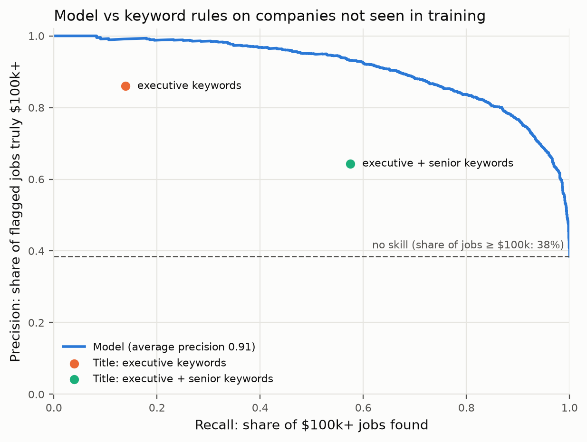
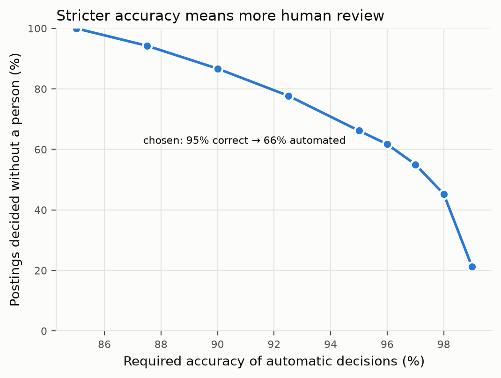

# Executive Job Screener

**Does a job posting clear a $100k salary benchmark, even when it doesn't state a salary?**
A tested data pipeline and text classifier that screens job postings against an executive
salary benchmark, and routes only the uncertain cases to a human reviewer.

Built on 123,849 real LinkedIn job postings (2023–2024), with every analytical decision
documented in a [decision log](docs/decisions.md).

## Results at a glance

Evaluated on **companies the model never saw during training**:

| | Result |
|---|---|
| Model F1 | **0.823**, vs 0.607 for the best job-title keyword rule |
| Average precision (area under the precision–recall curve) | **0.909** (no-skill level: 0.385) |
| Calibration error | **0.024**: when the model says 80%, about 80% are above $100k |
| Review routing at 95% accuracy | **66% of postings decided automatically**; 34% go to a person |
| Applied to 87,776 postings **without** a salary | **~34%** estimated above $100k; 16% auto-accepted, 31% sent to review |


## Try it

Score any job posting and see which words drove the decision (after the setup in
[Reproduce](#reproduce)):

```bash
streamlit run app/streamlit_app.py    # interactive app at http://localhost:8501
python scripts/screen_posting.py --title "Vice President of Finance" --experience Executive
```

Both use the same tested explanation code. For logistic regression the explanation is exact:
the intercept plus all word contributions add up to the model's score.

## How it works

```
raw CSV files ──► DuckDB database ──► salary rules ──► labelled postings ──► model ──► three queues
                  (ingestion)         (annualise,      (35,573 plausible     (TF-IDF +   auto-accept
                                       flag errors)     salaries)            logistic    human review
                                                                             regression) auto-reject
```

1. **Data quality first.** Key integrity checks, salary annualisation to full-time-equivalent
   pay, and a plausibility band that quarantines mislabelled salaries (e.g. yearly amounts
   labelled "per hour") instead of deleting or guessing them.
2. **Bias and leakage.** Only 29% of postings disclose a salary, and disclosure is driven
   mainly by state pay-transparency laws, so location is a model feature and results are
   reported per region. Salary amounts in the description text are stripped before
   modelling, because they would let the model read the answer.
3. **Honest evaluation.** Train/test split by company (a random split leaks near-identical
   postings: 6.8% of test postings had an identical twin in training), baselines evaluated
   on the same test set, calibration and subgroup analysis.
4. **Review routing.** Two thresholds, chosen by grouped cross-validation on the training
   companies only, make every automatic decision at least 95% accurate.



## Key findings

- **Most $100k+ jobs are not "executive" titles.** A keyword rule on Director/VP/Chief is 85%
  precise but finds only 13% of them; controllers, engineers and attorneys make up much
  of the rest.
- **Salary disclosure is driven by law, not seniority.** Pay-transparency states disclose
  50% of salaries vs 22% elsewhere; directors and executives disclose *more* often than
  average.
- **The model's most confident mistakes are often data errors**, e.g. a forklift operator
  listed at $113,048. Sorting by model–label disagreement gives a short review list.
- **12,623 postings without a structured salary mention one in their text**, a source of up
  to ~35% more labelled data with a careful extraction step.

All decisions, with evidence and rejected alternatives: [docs/decisions.md](docs/decisions.md)
(D-001 to D-011).

## Limitations

- **Weaker where it matters most.** F1 is 0.78 in states without pay-transparency laws, where
  73% of postings without a salary are located; 0.78 is the realistic figure for that use.
- **Unobservable bias.** If the best-paying employers within a region systematically hide
  salaries, no observable data can detect it (D-005).
- **The $100k line is a hard cut-off.** 39% of errors are within $10k of it.
- **US data, 2023–2024**, and LinkedIn postings only.

## Reproduce

Requires Python 3.12+ (developed with 3.15.1 on macOS).

```bash
git clone https://github.com/nour-nessah/exec-job-screener.git
cd exec-job-screener
python3 -m venv .venv
source .venv/bin/activate
python -m pip install -r requirements.txt
python -m pip install -e .
```

Download the dataset from
[Kaggle: LinkedIn Job Postings (2023–2024)](https://www.kaggle.com/datasets/arshkon/linkedin-job-postings)
and extract it into `data/raw/linkedin/` (so that `data/raw/linkedin/postings.csv` exists).

```bash
python scripts/build_db.py            # load raw CSVs into data/processed/linkedin.duckdb
python -m pytest                      # 53 tests (data tests are skipped without the database)
python scripts/train_model.py         # train and evaluate the model
python scripts/plot_pr_curve.py       # precision-recall curve vs baselines
python scripts/check_calibration.py   # calibration
python scripts/error_analysis.py      # subgroups and error analysis
python scripts/evaluate_routing.py    # review routing and workload curve
python scripts/score_unlabelled.py    # score all postings without a salary
```

## Project structure

```
src/exec_screener/   shared logic: salary rules, text cleaning, baselines, dataset, model, routing
scripts/             one script per analysis step (data checks, training, evaluation, figures)
tests/               unit tests (hand-made inputs) and data-quality tests (real database)
docs/decisions.md    decision log: evidence and alternatives for every analytical choice
reports/figures/     figures used in this README
```

## Data and licences

- **Data:** [LinkedIn Job Postings (2023–2024)](https://www.kaggle.com/datasets/arshkon/linkedin-job-postings)
  by Arsh Koneru and Zoey Yu Zou, licensed under
  [CC BY-SA 4.0](https://creativecommons.org/licenses/by-sa/4.0/). The data is **not**
  redistributed in this repository. It was cleaned and transformed as described in the
  decision log. Figures and derived statistics in this repository are shared under
  CC BY-SA 4.0.
- **Code:** [MIT License](LICENSE).

## Author

Nour El Houda Nessah, B.Sc. Statistics and Data Science, LMU Munich ·
[GitHub](https://github.com/nour-nessah)